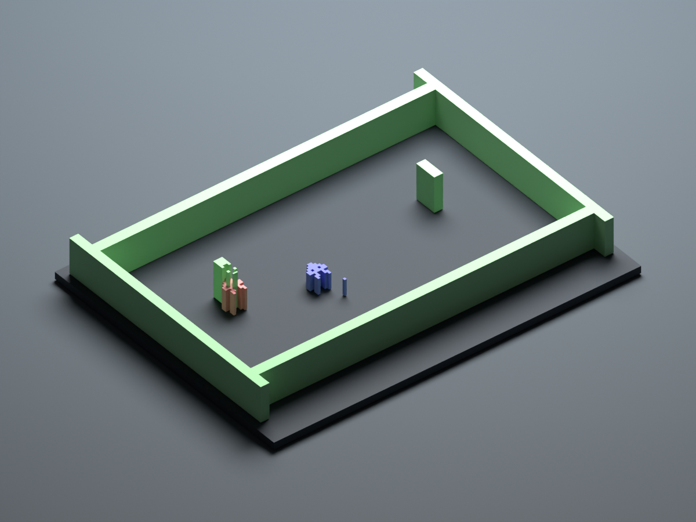

# Atari Diorama

A working Windows native-emulation prototype, plus native iOS application source for a tabletop Atari 2600 diorama. A real Stella core runs the cartridge. A separate renderer reconstructs its pixels into individual volumetric objects.

**Current status: 16 native tests pass. The user reports that the earlier build's AR works with the test cartridge and their own Atari ROMs on their iPhone. Private Wi-Fi multiplayer is implemented and undergoing hosted verification; its two-phone AR behavior still needs device testing.** The commercial game profiles remain explicit experiments rather than independently certified compatibility results. See [compatibility and milestone results](docs/COMPATIBILITY.md).

[Successful unsigned build #1](https://github.com/CreationsBy/AR-Atari-Emulator/actions/runs/39179809317) · [Download IPA and matching source artifact](https://github.com/CreationsBy/AR-Atari-Emulator/actions/runs/39179809317/artifacts/12155528893). The hosted artifact expires November 1, 2026 at 7:15 PM EST; later pushes can produce a fresh build. Its [verification record](docs/evidence/ios-build.json) identifies the exact built commit and IPA checksum.

## Run the working prototype now

The Windows library has been built in `build/native-host/AtariDiorama.dll`. From this project folder in PowerShell:

```powershell
# This computer already has this Python installation:
$projectPython = 'C:\Program Files\Blender Foundation\Blender 5.2\5.2\python\bin\python.exe'
& $projectPython scripts/preview_server.py
```

Open **http://127.0.0.1:8260**. Use WASD/arrows and Space, or the on-screen buttons. Drag to orbit; scroll to zoom. Click **Enable sound** for original TIA audio. Enter selects a room; R resets. The viewer also accepts user-supplied ROMs and can save/load one in-memory state. Its original framebuffer comparison is live.

This is an actual native Stella process feeding a WebGL inspection tool. The iOS app is written separately in SwiftUI/RealityKit and does not embed this webpage. The local preview does not validate ARKit or the iPhone UI. Browser visual testing could not be performed in this session; its endpoint, input path and JavaScript syntax were checked.

On a different Windows computer, install Python 3.12+, then use `scripts/Build-Windows.ps1` to download a checksum-verified portable compiler, build and run the tests. `scripts/Start-Preview.ps1` finds Python automatically. VS Code tasks are included. Stop the preview before rebuilding its DLL.

## What is implemented

- A vendored, pinned Stella 2014 core with 6507, TIA, RIOT and cartridge hardware. Native joystick and absolute paddle input; the latter is tested with an original capacitor-measurement ROM.
- `.a26`, `.bin` and raw `.rom` import in the iOS source. The frontend limits input to 2 KB–1 MB raw cartridges; streaming MovieCart, archives and specialized keypad peripherals are outside this prototype.
- Per-frame RGBA, raw TIA palette indices, RIOT RAM snapshots, and bounded TIA register-write traces.
- Hash-selected JSON profiles; connected-component segmentation; exact pixel-mask matching; nearest-component tracking; rectangular run merging that preserves holes; per-object heights, elevations and upright/tabletop geometry.
- An original 4 KB cartridge with joystick movement, an autonomous actor, playfield obstacles, hardware collision feedback, a Fire missile, TIA sound and room-color transitions. Its source and reproducible assembler are included.
- SwiftUI library, Files import, touch joystick/Fire, console switches, two-player selection, paddle slider, Bluetooth gamepad mapping, settings and a diagnostic inspector.
- RealityKit meshes with per-object updates and cached geometry. ARKit horizontal-plane preview, tap placement, world anchor, physical camera view, pinch/rotation, size presets, tilt and virtual inspection cameras.
- Original audio through a bounded native ring and AVAudioSourceNode; pause/resume; ROM/core/profile/controller-bound save files; scene reconstruction after restore.
- A GitHub Actions workflow for native tests, hosted Apple compilation, archive logging, unsigned IPA packaging or signed export, and matching-source publication.
- Private room-code multiplayer for two iPhones on the same Wi-Fi: host-only ROM/emulation, a separate Player 2 controller, synchronized geometry/framebuffer/original audio, and AR world-map sharing for independent camera perspectives. See [the host/join walkthrough](docs/LOCAL_MULTIPLAYER.md). The test cartridge's red actor becomes controllable by Player 2 upon their first input.

## Verify locally

```powershell
& $projectPython scripts/verify_vendor.py
& $projectPython scripts/validate_project.py
& $projectPython -m unittest discover -s tests -v
& $projectPython scripts/capture_evidence.py
```

Evidence includes raw framebuffer PNG, original audio WAV, register trace CSV, geometry JSON and measured host processing times. [The captured 3D render](docs/evidence/reconstruction-3d.png) renders those actual generated boxes offline; it is not an iPhone or AR screenshot.



## Build for iPhone from Windows

Follow [the repository, hosted build and sideloading walkthrough](docs/BUILD_WINDOWS.md). The source is published at [CreationsBy/AR-Atari-Emulator](https://github.com/CreationsBy/AR-Atari-Emulator), and the first remote build passed. No personal Mac, local Xcode or local VM is needed. The default build is unsigned and must be re-signed before installation.

The [profile authoring guide](docs/PROFILES.md), [architecture](docs/ARCHITECTURE.md) and [physical-device test procedure](docs/DEVICE_TESTING.md) explain the next stages. No commercial profile is labelled full support.

## Foundation and licensing

Stella 2014 was selected for its small interpreter-based core, existing serializable state and direct TIA framebuffer access. Its older baseline can differ in accuracy from current Stella; compare difficult ROMs against current Stella before expanding support. [Libretro documents its origin, GPLv2 license and supported features](https://docs.libretro.com/library/stella2014/).

The design follows the publicly described principle of game-specific interpretation while the original ROM remains authoritative. [Geod Studio describes 3dSen's hand-authored profiles and real-time volumetric presentation](https://geodstudio.net/); none of its proprietary code is used.

Read [LICENSE](LICENSE) and [third-party notices](THIRD_PARTY_NOTICES.md) before redistributing a binary. Commercial ROMs are never bundled.
